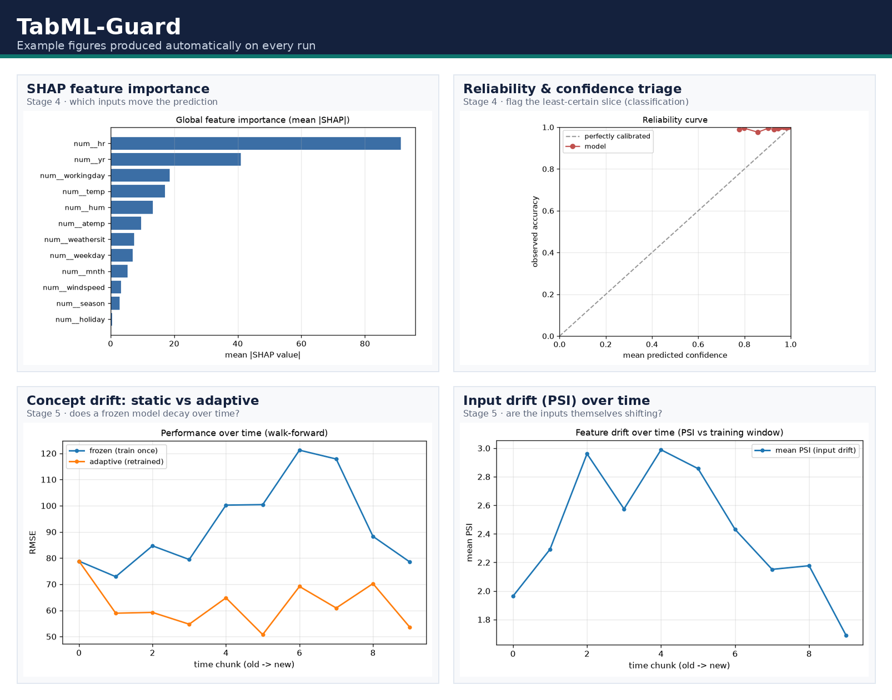
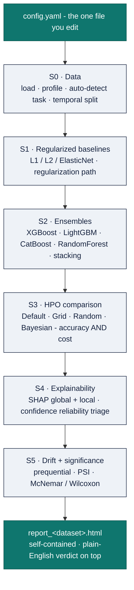
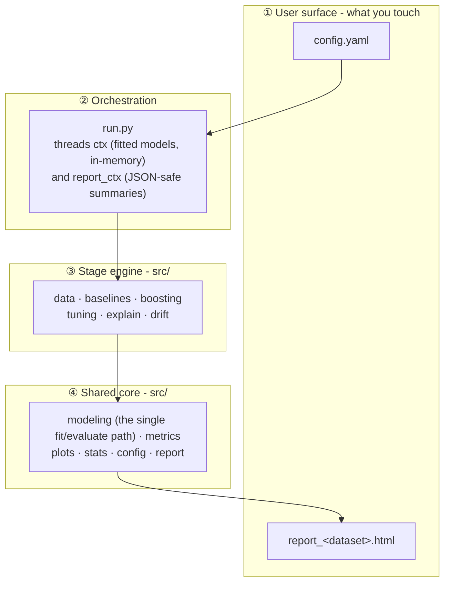
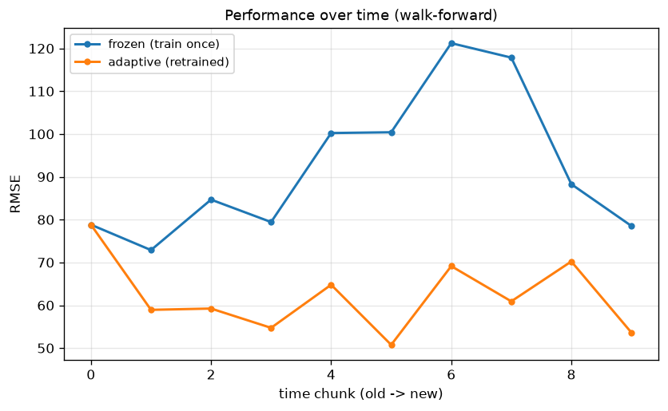

# TabML-Guard


**A configuration-driven AutoML pipeline for real-world, time-ordered tabular data - from raw table to a self-contained, explainable, drift-aware HTML report, by editing one file.**

Point TabML-Guard at any tabular dataset (an OpenML name/id or a local CSV), name the target column and an optional time column, and it runs the entire modern supervised-learning workflow end to end: it auto-detects classification vs. regression, splits the data *by time*, fits regularized baselines, trains boosting ensembles and a stacking meta-model, compares four hyperparameter-optimization strategies on **accuracy *and* compute cost**, explains the winning model with SHAP, flags its least-reliable predictions, monitors concept drift over time, runs statistical significance tests, and writes a single self-contained HTML report with a plain-English verdict on top.

The **tool is the deliverable**; the datasets are just demonstrations. Nothing in `src/` knows about any specific dataset - every dataset detail lives in the config.



---

## Table of contents

- [Why TabML-Guard](#why-tabml-guard)
- [Installation](#installation)
- [Quickstart](#quickstart)
- [The pipeline](#the-pipeline)
- [Architecture & layers of abstraction](#architecture--layers-of-abstraction)
- [Configuration reference](#configuration-reference)
- [Run it on your own data](#run-it-on-your-own-data)
- [Outputs](#outputs)
- [Honest evaluation: temporal split & drift](#honest-evaluation-temporal-split--drift)
- [Extending TabML-Guard](#extending-tabml-guard)
- [Project structure](#project-structure)
- [Engineering notes](#engineering-notes)
- [Documentation](#documentation)
- [Literature backing](#literature-backing)
- [Roadmap & limitations](#roadmap--limitations)
- [License](#license)

---

## Why TabML-Guard

Most tabular ML code is written once, for one dataset, and quietly bakes in assumptions that make its numbers optimistic - it shuffles time-ordered rows, tunes on the test set, or reports a single accuracy figure with no notion of whether the model will still work next month. TabML-Guard is the opposite: a **reusable system** that makes the honest, defensible version of that workflow the default.

- **One file to touch.** Every dataset-specific decision lives in `config.yaml`. The pipeline code is generic.
- **Leakage-safe by construction.** The preprocessor is re-fit inside every cross-validation fold, and the temporal test set is never seen during model selection or tuning.
- **Cost-aware tuning.** It doesn't just ask "does Bayesian optimization win?" - it reports the wall-clock and evaluation budget each strategy spent, so you can decide whether tuning is worth it.
- **Trust, not just scores.** SHAP explains *why*, a reliability layer flags *which predictions to double-check*, and drift monitoring answers *will this keep working?*
- **Graceful degradation.** Optional dependencies (CatBoost, Optuna, `river`, SHAP) are lazily imported; if one is missing, that step is skipped with a note instead of crashing the run.
- **A report you can hand to a non-expert.** The output is a single self-contained `.html` file - no server, no notebook, no external assets.

---

## Installation

Requires **Python 3.10–3.12**.

```bash
# 1. Clone
git clone https://github.com/Ayush-Gole8/tabml.git
cd tabml-guard

# 2. Create and activate a virtual environment
python -m venv .venv
# Windows:
.venv\Scripts\activate
# macOS / Linux:
source .venv/bin/activate

# 3. Install dependencies
pip install -r requirements.txt
```

Dependencies are grouped by purpose in `requirements.txt`: a core data stack (numpy, pandas, scipy, pyyaml, joblib), the models (scikit-learn, XGBoost, LightGBM, CatBoost), Bayesian tuning (Optuna), explainability (SHAP), drift detectors (`river`, optional), significance testing (statsmodels), and plotting (matplotlib). Anything marked optional degrades gracefully if absent.

---

## Quickstart

The repository ships ready to run on the ELEC2 electricity dataset, which is pulled straight from OpenML with no download step:

```bash
python run.py --config config.yaml
```

When it finishes, open the report:

```
results/report_electricity.html
```

The report filename is derived from the dataset, so running several datasets leaves you one report each (`report_<dataset>.html`) rather than overwriting a single file. A pre-generated example - [`results/report_electricity.html`](results/report_electricity.html) - is committed so you can see the output before running anything.

---

## The pipeline

TabML-Guard runs six stages (S0–S5) and then assembles the report. Each stage hands the next an in-memory context object carrying the fitted models and the running "best model so far."



| Stage | Module | What it does |
|---|---|---|
| **S0 - Data** | `src/data.py` | Loads from OpenML or CSV, profiles the columns, auto-detects the task from the target, builds a leakage-safe preprocessor, and splits **by time** (earliest rows train, latest rows test). |
| **S1 - Baselines** | `src/baselines.py` | Fits regularized linear baselines (L1/L2/ElasticNet for classification; Ridge/Lasso/ElasticNet for regression) and traces a **regularization path** so the bias–variance behaviour is visible. |
| **S2 - Ensembles** | `src/boosting.py` | Trains XGBoost, LightGBM, CatBoost and RandomForest, plus a **stacking** meta-model, and picks the best booster to carry into tuning. |
| **S3 - HPO comparison** | `src/tuning.py` | Runs Default vs Grid vs Random vs **Bayesian (Optuna)** on the best booster at an **equal budget**, recording accuracy *and* wall-clock/evaluation count - an explicit "is tuning worth the cost?" answer. |
| **S4 - Explainability** | `src/explain.py` | Computes SHAP (model-type-aware: tree/linear/agnostic) for global and local attributions, then a **reliability layer** that routes the least-confident predictions to human review. |
| **S5 - Drift & significance** | `src/drift.py`, `src/stats.py` | Walk-forward (prequential) monitoring of a frozen vs. periodically-retrained model, PSI input-drift tracking, and **McNemar** (classification) / **Wilcoxon** (regression) tests on the key model comparisons. |
| **Report** | `src/report.py` | Assembles everything into one self-contained HTML file with a verdict panel on top. |

---

## Architecture & layers of abstraction

TabML-Guard is deliberately layered so that **the surface a user touches is tiny**, while the machinery underneath stays open for developers. From top to bottom, each layer only depends on the one below it:



**As a user**, you interact with exactly two things: the config you write and the report you read. Everything else is an implementation detail.

**As a developer**, the map below tells you where each concern lives and whether you'd ever need to touch it:

| Module | Layer | Responsibility | Touch it? |
|---|---|---|---|
| `config.yaml` | ① surface | Every dataset-specific decision | **Always** - this is the interface |
| `run.py` | ② orchestration | Runs the stages in order; owns `ctx` and `report_ctx` | Rarely |
| `src/config.py` | core | Loads/validates YAML into typed dataclasses | Only to add a config field |
| `src/data.py` | engine | Load, profile, task-detect, preprocess, temporal split | To support a new source |
| `src/modeling.py` | core | **The single `fit_evaluate` path** every model goes through | Rarely - it's the invariant |
| `src/metrics.py` | core | Task-aware metrics | To add a metric |
| `src/baselines.py` | engine (S1) | Regularized baselines + regularization path | To change baselines |
| `src/boosting.py` | engine (S2) | Boosters + stacking | To add a booster |
| `src/tuning.py` | engine (S3) | The four HPO strategies + cost accounting | To add a strategy |
| `src/explain.py` | engine (S4) | SHAP + reliability triage | To change explanations |
| `src/drift.py` | engine (S5) | Prequential drift + PSI + retraining | To change drift logic |
| `src/stats.py` | core | McNemar / Wilcoxon significance tests | Rarely |
| `src/plots.py` | core | matplotlib figure helpers (headless) | To restyle figures |
| `src/report.py` | core | Pure-stdlib self-contained HTML assembly | To restyle the report |

The two objects `run.py` threads through the stages are worth calling out, because they encode a clean separation:

- **`ctx`** - an in-memory scratchpad holding *fitted estimators, predictions, and the running best model*. It is never serialized.
- **`report_ctx`** - only *JSON-safe per-stage summaries*. This is what gets written to `results/tables/results.json` and handed to the report builder.

---

## Configuration reference

The config is a single YAML file parsed into typed dataclasses (`src/config.py`), validated up front with actionable error messages. Every key under `dataset:` maps one-to-one to a loader field, so a typo raises immediately rather than being silently ignored.

### `dataset`

| Key | Type | Default | Meaning |
|---|---|---|---|
| `source` | `openml` \| `csv` | `openml` | Where the data comes from. |
| `name` | string | `null` | OpenML dataset name (e.g. `electricity`). Uses `version`. |
| `data_id` | int | `null` | OpenML numeric id (canonical). **Overrides `name`** if both are set. |
| `path` | string | `null` | CSV path relative to the project root (required when `source: csv`). |
| `version` | int | `1` | OpenML version (ignored when `data_id` is set). |
| `target` | string | - | **Required.** The column to predict. |
| `time_col` | string | `null` | Column giving chronological order. `null` → random split + drift skipped. |
| `use_time_as_feature` | bool | `false` | Keep the time column as a model input (normally used only for ordering). |
| `drop_cols` | list | `[]` | Columns to exclude: IDs, free text, and above all **leakage**. |

### Other sections

| Section · key | Default | Meaning |
|---|---|---|
| `task` | `auto` | `auto` \| `classification` \| `regression`. `auto` detects from the target. |
| `split.train_frac` / `split.test_frac` | `0.6` / `0.4` | Temporal split fractions (earliest → train, latest → test; no shuffle). |
| `models.boosters` | `[xgboost, lightgbm, catboost, random_forest]` | Which ensembles to train. |
| `models.stacking` | `true` | Add a stacking meta-model. |
| `tuning.budget_trials` | `40` | Optuna trials; Random search matched to the same budget. |
| `tuning.cv_splits` | `3` | Number of `TimeSeriesSplit` folds during tuning. |
| `tuning.scoring` | `null` | `null` → auto (ROC-AUC for classification, negative RMSE for regression). |
| `drift.n_chunks` | `10` | How many time-ordered chunks the test stream is cut into. |
| `drift.retrain` | `sliding` | `none` \| `periodic` \| `sliding` - how the adaptive model updates. |
| `report.title` | `"TabML-Guard Report"` | Title shown at the top of the report. |
| `report.fbeta` | `2.0` | β for the F-β score (2.0 weights recall higher). |
| `random_state` | `42` | Global seed for reproducibility. |
| `output_dir` | `results` | Where figures, tables, the model and the report are written. |

---

## Run it on your own data

Copy the closest shipped config, change `path` / `target` / `time_col` (and `drop_cols` if there's any leakage), and run. Nothing else changes:

```yaml
dataset:
  source: csv
  path: data/my_data.csv
  target: my_target_column
  time_col: my_timestamp_column   # or null if the data has no time order
  drop_cols: [row_id]             # exclude IDs / leakage
task: auto
```

```bash
python run.py --config configs/my_data.yaml
```

The repo ships **five ready-to-run configs** that between them exercise every branch of the tool - both task types, the significance-test swap, the classification-only reliability layer, categorical one-hot encoding, and leakage removal:

| Config | Task | Demonstrates |
|---|---|---|
| `config.yaml` (electricity) | Classification | The baseline case; runs from OpenML with no download. |
| `configs/occupancy_detection.yaml` | Classification | A clean, all-numeric second classification story. |
| `configs/metro_traffic.yaml` | Regression | Flips the whole pipeline to RMSE/MAE/R² + Wilcoxon. |
| `configs/appliances_energy.yaml` | Regression | Dense numeric data - best case for PSI drift + the regularization path. |
| `configs/bike_sharing.yaml` | Regression | The `drop_cols` leakage demo. |

> See **[DATASETS.md](DATASETS.md)** for the full guide: where to download each CSV, what insight each run should surface, and the two built-in safety nets (a wrong column name prints the available columns; a high-cardinality categorical warns before it blows up memory).

---

## Outputs

Every run writes into `output_dir` (default `results/`):

```
results/
├── report_<dataset>.html    # ← the headline deliverable: open this
├── best_model.pkl           # the best fitted pipeline (joblib) - ready to reuse
├── tables/
│   ├── profile.json         # dataset profile (shape, dtypes, target stats, time span)
│   └── results.json         # JSON-safe per-stage summaries (the report's data)
└── figures/
    ├── shap_importance.png
    ├── reliability.png      # classification runs only
    ├── drift_performance.png
    └── drift_psi.png
```

The report embeds every figure as base64, so a single `.html` file is fully portable - you can email it or drop it on a static host and it just works. The figures above (shown in the banner) are the actual PNGs a run produces.

---

## Honest evaluation: temporal split & drift

The feature that most separates TabML-Guard from a typical notebook is that it never pretends the future is available at training time.


When a `time_col` is set, rows are sorted chronologically and split by time - the model trains on the past and is tested on the future. The test stream is then cut into `n_chunks` ordered slices, and two models are compared across them:

- a **frozen** model (trained once, never updated), and
- an **adaptive** model that, for each chunk, *predicts first and only then retrains* on it (`none` / `periodic` / `sliding` window) - so there is never any look-ahead.

Alongside performance, a **Population Stability Index (PSI)** trajectory tracks whether the *inputs themselves* are shifting, and McNemar/Wilcoxon tests confirm whether the differences are statistically real rather than noise. The gap between the frozen and adaptive curves is a direct, visual answer to "will this model keep working, and do I need to retrain it?"



---

## Extending TabML-Guard

Because every stage funnels through one shared `fit_evaluate` path and a typed config, extensions are localized:

- **Add a model / booster** → add a `_build_*` constructor in `src/boosting.py`, register it, and (optionally) add its search space to `src/tuning.py` so it can be tuned.
- **Add a metric** → extend `classification_metrics` / `regression_metrics` in `src/metrics.py`; every stage picks it up automatically.
- **Add a tuning strategy** → add a `_run_*` function in `src/tuning.py` following the existing `refit=False` → pick-from-CV → single refit contract, so its cost is measured the same way.
- **Add a drift detector** → extend `_detect_changes` in `src/drift.py` (the `river` ADWIN hook shows the pattern; it degrades gracefully when the library is absent).
- **Restyle the report** → it's pure-stdlib string assembly in `src/report.py`; no template engine to learn.

---

## Project structure

```
tabml-guard/
├── config.yaml            # the one file you edit per dataset (electricity demo)
├── configs/               # five ready-to-run example datasets
├── requirements.txt
├── run.py                 # entry point - orchestrates the six stages
├── src/
│   ├── config.py          # load + validate config into typed dataclasses
│   ├── data.py            # S0: load, profile, task-detect, preprocess, temporal split
│   ├── modeling.py        # shared fit/evaluate core (single source of truth)
│   ├── metrics.py         # task-aware metrics
│   ├── baselines.py       # S1: regularized baselines + regularization path
│   ├── boosting.py        # S2: boosting ensembles + stacking
│   ├── tuning.py          # S3: Default / Grid / Random / Bayesian + cost accounting
│   ├── explain.py         # S4: SHAP + reliability triage
│   ├── drift.py           # S5: prequential drift + PSI + retraining
│   ├── stats.py           # McNemar's / Wilcoxon significance tests
│   ├── plots.py           # headless matplotlib figure helpers
│   └── report.py          # self-contained HTML report assembly
├── assets/                # README images
├── results/               # generated: report, figures, tables, best_model.pkl
├── DATASETS.md            # guide to running on other datasets
├── PROJECT_PLAN.md        # full design rationale + per-stage paper mapping
└── EVALUATION_PREP.md     # deep-dive walkthrough (layman → technical)
```

---

## Engineering notes

A few decisions that keep the numbers honest and the code robust:

- **One evaluation path.** Every model - baseline, booster, stacked, or tuned - is scored through the same `fit_evaluate` in `src/modeling.py`, so leaderboard rows are always comparable.
- **Leakage safety in three places.** The preprocessor is cloned and re-fit inside each pipeline (never fit on the whole dataset); the temporal test set is untouched during tuning and the regularization path (which uses an internal split of the training data only); and the adaptive drift model refits its preprocessor on each window.
- **Cross-validation correctness.** Stacking uses a `StratifiedKFold`/`KFold` partition (scikit-learn's `cross_val_predict` requires one), while Grid/Random tuning can safely use `TimeSeriesSplit` (they use `cross_validate`). This subtlety is handled for you.
- **Single-threaded base learners under parallel search.** Base learners are forced to one thread while the search parallelizes, avoiding cores² oversubscription.
- **Never crashes on a missing optional.** SHAP, CatBoost, Optuna and `river` are all lazily imported; a missing one skips its step with a recorded note.

---

## Documentation

| Document | What's in it |
|---|---|
| **[DATASETS.md](DATASETS.md)** | How to run on other datasets, where to get each CSV, and the insight each run should show. |
| **[PROJECT_PLAN.md](PROJECT_PLAN.md)** | Full design rationale, per-stage technique choices, and the mapping to the source papers. |
| **[EVALUATION_PREP.md](EVALUATION_PREP.md)** | An end-to-end walkthrough of the whole system, plain-English first then technical in depth. |

---

## Literature backing

The design synthesizes five peer-reviewed papers (all from Q1 journals) into one pipeline; each stage traces back to one of them:

| Paper | Journal | Informs |
|---|---|---|
| RegStack | *Expert Systems with Applications* (2025) | Regularized baselines + stacking (S1, S2) |
| Bayesian-Optimized XGBoost | *Expert Systems with Applications* (2026) | The tuning + SHAP backbone (S2–S4) |
| SHAP Error-Compensation | *IEEE Transactions on Artificial Intelligence* (2025) | Reliability-aware explainability (S4) |
| Concept Drift with Continuous Kernel Learning | *Information Sciences* (2024) | Drift monitoring; motivates the ELEC2 dataset (S5) |
| Spectral-Clustering Parameter Tuning | *IEEE Access* (2025) | The "parameters matter as much as algorithms" theme (lit-review) |

See `PROJECT_PLAN.md` for the full stage-by-stage mapping and DOIs.

---

## Roadmap & limitations

- **Compute-first honesty.** The point of the HPO stage is to *measure* the cost/benefit of tuning, not to guarantee tuning always wins - on easy datasets a regularized baseline can match tuned boosters, and the report says so.
- **Monocular drift signals.** PSI and prequential error are strong, cheap drift indicators but do not attribute *why* a distribution moved; deeper causal drift analysis is out of scope.
- **Single-machine scope.** The pipeline targets datasets that fit comfortably in memory on one machine (tens of thousands to low millions of rows); it is not a distributed training system.
- **Possible next steps.** A small pytest suite + CI badge, a CLI flag to select a subset of stages, and optional export of the report to PDF.

---

## License

Released under the **MIT License** - see [LICENSE](LICENSE).

> This began as an Advanced Machine Learning mini-project and is maintained as a reusable tool. If you use it, a link back is appreciated.
